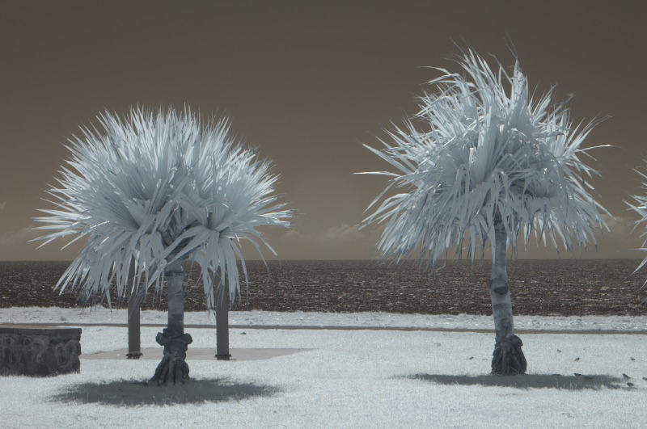
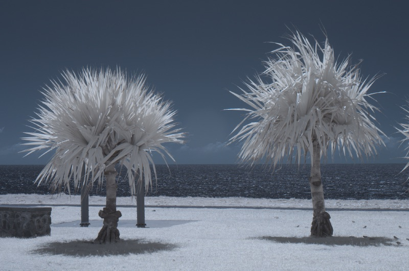

# IR Converter

A raw converter for **infrared photography**, running entirely in the browser.
It reads **NEF** (Nikon) and **DNG**, swaps red and blue directly in the raw data,
offers a white balance **without any temperature limit** with a live preview, and saves
**lossless DNG** and **JPEG**. Everything is computed locally in C/WebAssembly; there is
no server interaction. After the first visit the app works offline and can be installed
as an app; installed copies update themselves.

<p>


</p>

*Nikon D90, rendered by IR Converter. Left: as shot (1767 K). Right: red/blue
swapped, 6500 K.*

## Why

Infrared photos need two things that common raw converters handle poorly:

- **Red/blue channel swap** for the classic look (blue sky, white foliage).
- **Extreme white balance.** Adobe Camera Raw stops at 2000 K, so the usual workaround
  is a custom `.dcp` camera profile that shifts the temperature scale.

IR Converter does both and writes the result into a standard DNG that Lightroom and Camera Raw
open as shot. The workaround profile is created automatically.

## Use

- **Open** a file, or drop it onto the window.
- **Swap red/blue:** the swap happens in the raw data, before white balance.
- **Temperature:** the slider covers ×¼ to ×4 of the current value and re-centres
  whenever you release it, so it has no end stop. The field next to it accepts any value
  above 0 K, for example `350`, `0.5`, `120k`. **As shot** restores the value from the file.
- **Save DNG / Save JPG** writes `<name>-IR.dng` or `.jpg`. On touch devices the share
  sheet opens instead (for example “Save to Files”).

The interface is in German or English, following the browser language.

## Build

Requires macOS with Apple's Command Line Tools (`xcode-select --install`), nothing else.
Builds run offline in a sandbox that blocks the network and only allows writes below `build/`.

```sh
make                    # builds the WASM linker, engine.wasm and the website in build/web/
make serve              # http://localhost:8080/ (Ctrl-C to stop)
make check              # native checks, WASM cross-check, comparison with Apple's raw engine
make clean              # removes build/
make rebuild-toolchain  # rebuilds the linker
```

Apple Clang compiles C to `wasm32`. The only other tool is the small WebAssembly linker
`wcc` from [XCC](https://github.com/tyfkda/xcc) (MIT). It is bundled as an unmodified
source archive and built at the start of the first `make`; see
[vendor/SOURCE_ARCHIVES.md](vendor/SOURCE_ARCHIVES.md). No Node, Emscripten, CMake or Rust.

`make check` uses sample files in `samples/`, which are not part of the repository:
`DSC_0080.NEF` and `DSC_0080.DNG`, the same NEF converted by Adobe DNG Converter.
Without them, only the checks that need no sample files run.

## Deploy

Copy all of `build/web/` to a static HTTPS host, including `releases/`. Subdirectories
work. Serve `.wasm` as `application/wasm`. Revalidate `index.html`, `service-worker.js`,
`site.webmanifest`, `favicon.ico` and `apple-touch-icon.png`; everything under
`releases/` can be cached forever.

The service worker downloads a new release completely before activating it. Without an
open image the app switches to the new release at once; with an image open, it switches
on the next start. Older releases are then deleted. The release id is shown on the start
screen.

## How it works

### Red/blue swap in the raw data
On a Bayer sensor the CFA pattern is rewritten (e.g. GBRG → GRBG), so red photosites
become blue and vice versa. Sensor data stays bit-exact, every raw converter honours it,
and the swap precedes white balance and colour matrices. Hues therefore differ slightly
from a channel swap in sRGB (e.g. Photoshop's channel mixer).

### Unbounded temperature
Between 1000 K and 15000 K the scale is physical: the Planckian locus after Krystek (1985)
and camera matrices per the DNG specification. A real Planckian locus ends at both sides
(T → 0 and T → ∞ give finite white points), which is not enough for infrared. With the
swap, the D90's as-shot white lies beyond the blue end. Outside that range the camera
neutral therefore continues log-linearly in log(T). Every value above 0 K is distinct and
monotonic. The start value reproduces the file's white balance exactly; the tint is kept.

### Lossless DNG export
- **Raw data stays bit-exact.** DNG tiles are copied unchanged. NEF data is decompressed
  and stored as lossless JPEG, with the NEF curve as `LinearizationTable`.
- `AsShotNeutral` holds the chosen white balance.
- **Embedded profile “IR Converter”** (the `.dcp` trick, automated):
  - `ColorMatrix` is scaled so this white point reads about 5000 K in Camera Raw and
    Lightroom, so their slider starts mid-range.
  - `ForwardMatrix` reproduces the app's colours exactly according to the DNG
    specification.
  - The XMP sets `crd:CameraProfile="IR Converter"` and drops stored WB/profile settings.
- **Previews:** every embedded preview is re-rendered at its original size. None is
  added if there was none. NEF imports keep the NEF's preview sizes.
- **Fast-load proxies** (DNG 1.7, JPEG XL) hold camera RGB and follow the new white
  balance on their own. They are kept, except with the swap, where they are removed.
- The Nikon MakerNote is kept as `DNGPrivateData`; EXIF and GPS are preserved.

### JPEG export
Full resolution (Malvar-He-Cutler demosaicing), quality 75, 4:2:0, sRGB with the
embedded macOS sRGB ICC profile, EXIF preserved, orientation as EXIF tag.

The JPEG is also an **HDR photo with a gain map**. The main image is the ordinary SDR
JPEG, so every viewer shows it as before. Behind it, in an MPF container, follows a
greyscale gain map at half resolution that brightens highlights exactly like the HDR
preview (up to 3×). It is described twice:
- **ISO 21496-1**: Apple Photos/Preview (macOS 15, iOS 18 and later), Chrome.
- **Ultra HDR XMP** (Adobe gain map): Android, Chrome.

Viewers use as much of the gain as the display's headroom allows.

### HDR preview
On HDR displays the preview uses an extended-range WebGPU canvas
(`rgba16float`, Display P3, `toneMapping: extended`). Midtones match the SDR rendering;
highlights brighten smoothly up to 3× SDR white, and the display clips beyond its own
headroom. Browsers or displays without this support show the SDR preview. The header
shows “HDR” when it is active.

### Supported files
- **NEF:** lossy and lossless compressed, 12/14 bit, uncompressed.
  - Colour matrices and crop come from `core/cameras.c`; currently only the **Nikon D90**.
  - To add a model, convert one NEF with Adobe DNG Converter and copy `ColorMatrix1/2`,
    `ForwardMatrix1/2`, `DefaultCrop*`, `ActiveArea`, `WhiteLevel` and
    `BaselineExposure`.
  - Unknown models open with a warning and approximate colours.
- **DNG:** Bayer CFA, uncompressed or lossless JPEG, tiles or strips.
- **Not supported** (with a message): lossy or JPEG XL compressed raw data in DNG,
  linear (demosaiced) DNG, Nikon “High Efficiency” (TicoRAW), non-Bayer sensors.

NEF raw values are bit-identical to Adobe DNG Converter's. The NEF curve is interpolated
as in dcraw/LibRaw. Adobe interpolates slightly differently, which shifts tonal values
by up to about 1 %; the raw values themselves are the same.

## Checks

- `tests/core-check.c` covers:
  - decoders against Adobe DNG Converter;
  - temperature round trips from 10 K to 10⁶ K, and monotonicity from 1 K to 10⁹ K;
  - DNG export from the DNG and the NEF, each with and without swap: bit-exact raw data,
    CFA pattern, neutral, preview sizes and proxies;
  - JPEG export and the HDR preview.
- `tests/wasm-check.js` runs the same steps with `engine.wasm` in JavaScriptCore. DNG,
  JPEG and both previews must be byte-identical to the native build.
- `raw-reference` opens the exported DNGs with Apple's raw engine (ImageIO) and compares
  their colours with IR Converter's. For the JPEGs it checks:
  - the MPF index and the Ultra HDR XMP;
  - that ImageIO finds the ISO gain map;
  - that Core Image's HDR decode equals the SDR image times a gain between 1 and 3.

## Layout

- `core/`: the engine in freestanding C11 (TIFF, NEF, DNG, lossless JPEG, colour,
  rendering, JPEG, export), built natively and as WebAssembly.
- `web/`: user interface, worker, service worker and the WASM adapter (`native/`).
- `build-support/`: build scripts, XCC patch and small Objective-C host tools.
- `assets/`: `icon.png` (transparent, so iOS can place it on a light or dark background)
  and `icon-maskable.png` (full bleed). `build-support/tools/icon-art.m` draws both.
- `docs/`: README pictures.
- `tests/`, `vendor/`.

Proudly generated with Claude
